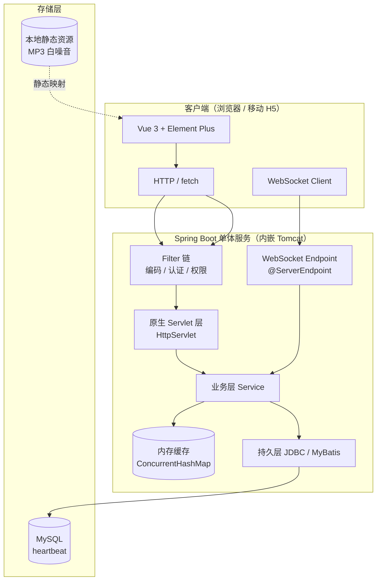
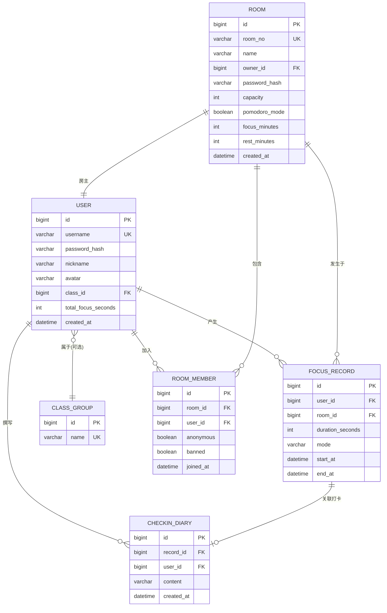
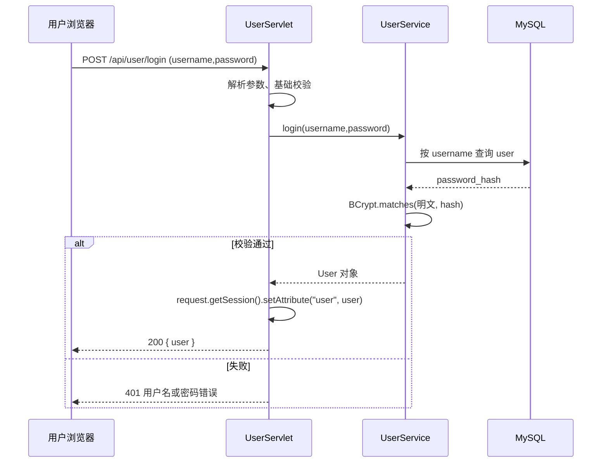
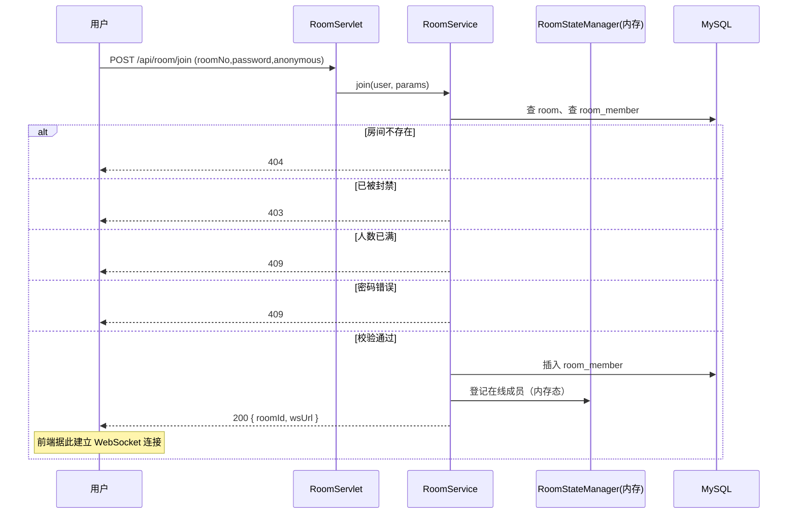
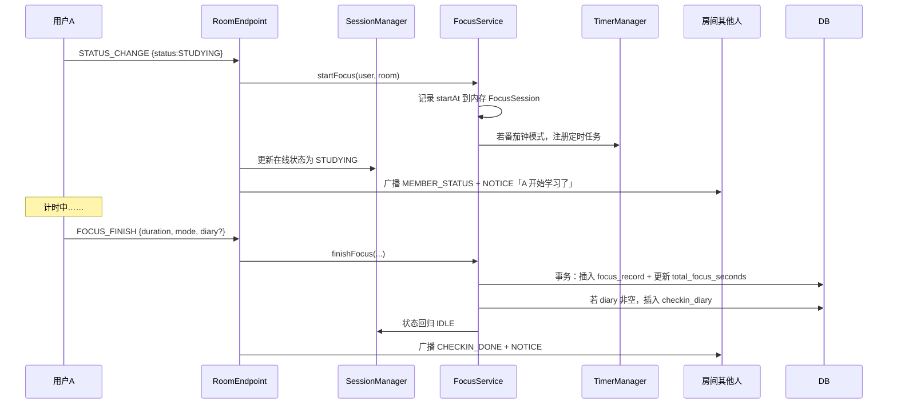
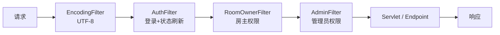

# 「心跳」在线自习室 — 技术设计文档

| 项目 | 内容 |
|------|------|
| 项目名称 | 心跳（HeartBeat）在线自习室 |
| 文档版本 | v1.1 |
| 编写日期 | 2026-11-20 |
| 最近更新 | 2026-11-20（新增第 19 章「管理后台与 RBAC 权限设计」，含全局管理员角色） |
| 项目定位 | 极简网页版在线自习室：多人共处一室、实时看见彼此状态、共同计时、完成后打卡、统计专注时长并排名 |

---

## 目录

1. [项目定位与开发原则](#1-项目定位与开发原则)
2. [总体架构](#2-总体架构)
3. [技术栈与选型理由](#3-技术栈与选型理由)
4. [系统分层与模块拆分](#4-系统分层与模块拆分)
5. [数据库设计](#5-数据库设计)
6. [领域模型与核心概念](#6-领域模型与核心概念)
7. [REST API 接口清单](#7-rest-api-接口清单)
8. [WebSocket 消息协议](#8-websocket-消息协议)
9. [核心流程设计](#9-核心流程设计)
10. [并发与缓存设计](#10-并发与缓存设计)
11. [认证、会话与权限拦截](#11-认证会话与权限拦截)
12. [计时、统计与排行榜](#12-计时统计与排行榜)
13. [专项功能设计](#13-专项功能设计)
14. [前端设计](#14-前端设计)
15. [部署与运行](#15-部署与运行)
16. [面试要点速查](#16-面试要点速查)
17. [迭代规划](#17-迭代规划)
18. [实习导向的技术演进](#18-实习导向的技术演进)
19. [管理后台与 RBAC 权限设计](#19-管理后台与-rbac-权限设计)

---

## 1. 项目定位与开发原则

### 1.1 项目定位

一个极简的网页版在线自习室。用户可以创建或加入房间，看到其他人的实时学习状态，共同计时，完成目标后打卡；系统统计专注时长并进行排名。核心体验是「**陪伴感 + 可见的专注积累**」。

### 1.2 开发原则

| 层面 | 选型 | 原则说明 |
|------|------|----------|
| 后端框架 | Servlet + Spring Boot | 以现有技术栈为核心，通过原生 Servlet 加深对底层的理解 |
| 实时通信 | Tomcat 原生 WebSocket | 基于 Socket 与 HTTP 升级，与网络知识无缝衔接 |
| 数据存储 | MySQL + 内存缓存（ConcurrentHashMap） | 兼顾持久化与并发性能 |
| 前端 | Vue 3 + Element Plus | 只做必要交互，不搞花哨特效 |
| 登录态 | 用户名 + 密码，Session 保持 | 简单可靠 |

### 1.3 功能清单

- 用户注册 / 登录（用户名 + 密码，Session 保持登录态）
- 创建自习室（房间名、可选密码、人数上限）
- 加入自习室（房间号或列表选择，密码校验）
- 实时在线列表（学习中 / 休息中状态）
- 开始 / 结束学习（计时器状态同步给房间所有人）
- 打卡日记（结束学习后可选写一句感想，存入个人记录）
- 番茄钟模式（25 分钟专注 + 5 分钟休息，自动切换并提示）
- 白噪音背景（雨声、咖啡馆等本地 MP3）
- 每日 / 每周排行榜（按专注时长，可按班级分组，可配置）
- 学习日记查看（个人主页历史打卡记录 + 时长趋势图）
- 房间踢人 / 封禁（房主权限，Filter 拦截未授权操作）
- 消息通知（上下线、学习状态变化顶部提示）
- 匿名模式（加入房间时可选匿名）
- 管理后台（全局管理员：平台统计、用户封禁/解封、角色升降级、删除违规房间）
- 移动端 H5 适配

---

## 2. 总体架构

采用**前后端分离 + 单体后端**的架构。HTTP 负责「操作型」请求（登录、建房间、查记录），WebSocket 负责「实时型」推送（状态同步、计时广播、通知）。两者共享同一份业务状态与 Session 体系。



**关键设计点：**

1. **HTTP 与 WebSocket 共存于同一 Tomcat 端口。** WebSocket 握手本质是一次带 `Upgrade: websocket` 头的 HTTP 请求，Tomcat 在 HTTP 升级后把连接从 Servlet 容器「接管」为 WebSocket 连接。因此二者可以共享端口、共享 Session（握手阶段可读取 HttpSession）。
2. **状态源唯一。** 房间的在线成员、实时状态、计时进度在内存缓存中维护「实时真相」；专注时长的「最终结算」落 MySQL。内存负责快，MySQL 负责准与持久。
3. **无独立缓存中间件。** 用 JVM 内 ConcurrentHashMap 即可满足单机并发；若未来多实例部署，需替换为 Redis（见 [10.4](#104-从单机到多实例的演进)）。

---

## 3. 技术栈与选型理由

### 3.1 后端

| 技术 | 版本建议 | 用途 | 选型理由（面试可讲点） |
|------|----------|------|------------------------|
| Java | 17 LTS | 运行环境 | 长期支持，虚拟线程等新特性可拓展 |
| Spring Boot | 3.x | 容器与依赖管理 | 内嵌 Tomcat、自动配置，但 Web 层刻意用原生 Servlet |
| Servlet API | 6.0（jakarta.*） | HTTP 请求处理 | **故意不用 Spring MVC Controller**，直接继承 HttpServlet，掌握请求/响应对象、生命周期、线程模型 |
| Tomcat WebSocket | 随 Boot 内嵌 | 实时通信 | 基于 JSR-356（jakarta.websocket），理解 HTTP Upgrade 握手与 TCP 连接提升 |
| MyBatis（或 JDBC） | 3.5.x | 持久层 | 若想更底层可用原生 JDBC + 连接池；MyBatis 便于 SQL 掌控 |
| MySQL | 8.0 | 持久化 | InnoDB、事务、索引 |
| Jackson | 随 Boot | JSON 序列化 | 统一消息与接口数据格式 |

> **为什么用原生 Servlet 而不是 Spring MVC？** 面试叙事：Spring MVC 的 `DispatcherServlet` 本质就是一个 `HttpServlet`，它把请求分发给各个 `@Controller`。本项目跳过这层封装，直接用 `HttpServlet` 处理请求，可以清楚展示：请求对象如何解析参数、Session 如何存取、请求是多线程共享 Servlet 单例的（线程安全问题如何规避）。这是「知其所以然」的体现。

### 3.2 前端

| 技术 | 用途 |
|------|------|
| Vue 3（Composition API） | 组件与状态 |
| Vite | 构建工具 |
| Element Plus | UI 组件库 |
| Vue Router | 路由（登录页、房间页、个人主页、排行榜） |
| Pinia（可选） | 全局状态（当前用户、当前房间、WebSocket 连接） |
| ECharts（可选） | 时长趋势图 |
| 原生 WebSocket API | 与后端实时通信 |

### 3.3 开发环境

- JDK 17、Maven 3.8+、MySQL 8.0、Node.js 18+
- IDE：IntelliJ IDEA + VS Code

---

## 4. 系统分层与模块拆分

### 4.1 后端包结构

```
com.heartbeat
├── HeartBeatApplication.java          # 启动类
├── config
│   ├── ServletConfig.java             # 注册原生 Servlet（ServletRegistrationBean）
│   ├── WebSocketConfig.java           # 注册 ServerEndpointExporter
│   ├── FilterConfig.java              # 注册 Filter（FilterRegistrationBean）
│   └── CorsConfig.java                # 跨域配置
├── filter
│   ├── EncodingFilter.java            # 统一 UTF-8
│   ├── AuthFilter.java                # 登录态校验（放行的白名单除外）
│   └── RoomOwnerFilter.java           # 房主权限校验（踢人/封禁/设置）
├── servlet                            # 原生 Servlet 层（HTTP 入口）
│   ├── UserServlet.java               # /api/user/*
│   ├── RoomServlet.java               # /api/room/*
│   ├── RecordServlet.java             # /api/record/*
│   └── RankServlet.java               # /api/rank/*
├── websocket
│   ├── RoomEndpoint.java              # /ws/room/{roomId}  房间实时频道
│   ├── GlobalEndpoint.java            # /ws/global        全局通知频道
│   └── MessageEncoder/Decoder.java    # JSON 编解码
├── service
│   ├── UserService.java
│   ├── RoomService.java
│   ├── FocusService.java              # 计时与专注记录
│   ├── RankService.java
│   └── NotificationService.java       # 通过 WebSocket 推送通知
├── manager
│   ├── RoomStateManager.java          # 房间在线状态（ConcurrentHashMap）
│   ├── SessionManager.java            # userId <-> WebSocket session 映射
│   └── TimerManager.java              # 番茄钟定时任务（ScheduledExecutorService）
├── model
│   ├── entity / dto / vo / enums      # 实体、传输对象、视图对象、枚举
├── dao / mapper                       # 数据访问
└── util
    ├── JsonUtil.java
    ├── PasswordUtil.java              # 加盐哈希（BCrypt / PBKDF2）
    └── TimeUtil.java
```

### 4.2 前端目录结构

```
src/
├── api/                 # 封装 fetch 请求
├── views/
│   ├── Login.vue        # 登录/注册
│   ├── Lobby.vue        # 房间大厅（列表 + 创建）
│   ├── Room.vue         # 房间内页（核心）
│   ├── Profile.vue      # 个人主页（日记 + 趋势图）
│   └── Rank.vue         # 排行榜
├── components/
│   ├── FocusTimer.vue   # 计时器 / 番茄钟
│   ├── MemberList.vue   # 实时在线列表
│   ├── WhiteNoise.vue   # 白噪音播放器
│   └── NoticeToast.vue  # 顶部通知
├── router/
├── store/               # Pinia
├── ws/                  # WebSocket 连接封装（自动重连）
└── utils/
```

### 4.3 模块职责边界

| 模块 | 职责 | 不负责 |
|------|------|--------|
| Servlet 层 | 参数解析、调用 Service、返回 JSON | 业务逻辑、直接操作数据库 |
| WebSocket Endpoint | 连接生命周期、消息收发、推送 | 复杂业务（委托 Service） |
| Service | 业务编排、事务边界 | HTTP/WebSocket 协议细节 |
| Manager | 内存态维护、定时任务 | 持久化 |
| DAO | SQL 执行 | 业务判断 |

---

## 5. 数据库设计

### 5.1 ER 关系



### 5.2 表结构详述

#### `user` 用户表

| 字段 | 类型 | 约束 | 说明 |
|------|------|------|------|
| `id` | BIGINT | PK, AUTO_INCREMENT | 用户 ID |
| `username` | VARCHAR(32) | UNIQUE, NOT NULL | 登录用户名 |
| `password_hash` | VARCHAR(100) | NOT NULL | BCrypt 加盐哈希，绝不存明文 |
| `nickname` | VARCHAR(32) | | 昵称（匿名时房间内显示「匿名者」） |
| `avatar` | VARCHAR(255) | | 头像 URL，默认图 |
| `class_id` | BIGINT | FK → class_group.id, NULLABLE | 所属班级，排行榜分组用 |
| `total_focus_seconds` | INT | DEFAULT 0 | 累计专注秒数（冗余字段，加速排行榜） |
| `role` | VARCHAR(16) | DEFAULT 'USER' | 角色：`USER` 普通用户 / `ADMIN` 管理员（RBAC 简化模型） |
| `enabled` | BOOLEAN | DEFAULT TRUE | 账号是否启用；管理员全站封禁后置 FALSE |
| `created_at` | DATETIME | NOT NULL | 注册时间 |

> **冗余字段说明**：`total_focus_seconds` 也可由 `focus_record` 实时 SUM 得到，但排行榜是高频读、低频写，用冗余字段把 O(n) 聚合降为 O(1) 读取，是典型「空间换时间」。写入时在事务内同步更新，保证一致性。

> **Schema 演进**：`role` / `enabled` 是后加字段。因 MySQL 已有表，`CREATE TABLE IF NOT EXISTS` 不会自动补列——项目用 `AdminInitializer`（`ApplicationRunner`）通过 `DatabaseMetaData` 检测并幂等 `ALTER TABLE ADD COLUMN`，同时幂等创建默认管理员账号（见 19.2）。这是「已上线库如何平滑加字段」的真实工程场景。

#### `room` 房间表

| 字段 | 类型 | 约束 | 说明 |
|------|------|------|------|
| `id` | BIGINT | PK | 房间 ID |
| `room_no` | VARCHAR(12) | UNIQUE | 6 位房间号（加入用） |
| `name` | VARCHAR(64) | NOT NULL | 房间名 |
| `owner_id` | BIGINT | FK → user.id | 房主 |
| `password_hash` | VARCHAR(100) | NULLABLE | 房间密码，NULL 表示公开 |
| `capacity` | INT | DEFAULT 10 | 人数上限 |
| `pomodoro_mode` | BOOLEAN | DEFAULT false | 是否番茄钟模式 |
| `focus_minutes` | INT | DEFAULT 25 | 专注时长（分钟） |
| `rest_minutes` | INT | DEFAULT 5 | 休息时长（分钟） |
| `created_at` | DATETIME | | 创建时间 |

#### `room_member` 房间成员表

| 字段 | 类型 | 约束 | 说明 |
|------|------|------|------|
| `id` | BIGINT | PK | |
| `room_id` | BIGINT | FK, NOT NULL | |
| `user_id` | BIGINT | FK, NOT NULL | |
| `anonymous` | BOOLEAN | DEFAULT false | 是否匿名 |
| `banned` | BOOLEAN | DEFAULT false | 是否被封禁 |
| `joined_at` | DATETIME | | 加入时间 |

> 建立联合唯一索引 `UK(room_id, user_id)`，防止重复加入。

#### `focus_record` 专注记录表

| 字段 | 类型 | 约束 | 说明 |
|------|------|------|------|
| `id` | BIGINT | PK | |
| `user_id` | BIGINT | FK | |
| `room_id` | BIGINT | FK | |
| `duration_seconds` | INT | NOT NULL | 本次专注秒数 |
| `mode` | VARCHAR(16) | | `FREE` / `POMODORO` |
| `start_at` | DATETIME | | 开始时间 |
| `end_at` | DATETIME | | 结束时间 |

> 索引：`(user_id, end_at)` 支撑个人日记分页查询；`(room_id, end_at)` 支撑房间统计。

#### `checkin_diary` 打卡日记表

| 字段 | 类型 | 约束 | 说明 |
|------|------|------|------|
| `id` | BIGINT | PK | |
| `record_id` | BIGINT | FK → focus_record.id | 关联的专注记录 |
| `user_id` | BIGINT | FK | |
| `content` | VARCHAR(200) | | 一句感想，可空 |
| `created_at` | DATETIME | | |

#### `class_group` 班级分组表

| 字段 | 类型 | 约束 | 说明 |
|------|------|------|------|
| `id` | BIGINT | PK | |
| `name` | VARCHAR(64) | UNIQUE | 班级名 |

### 5.3 初始化 SQL 与配置项

- 班级分组为「可配置」：通过 `class_group` 表维护，管理员在后台增删；`user.class_id` 关联。
- 排行榜分组开关作为配置项 `rank.group-by-class=true/false`，关闭时按全体排名。

---

## 6. 领域模型与核心概念

| 概念 | 含义 | 生命周期 |
|------|------|----------|
| **在线状态** `OnlineStatus` | `STUDYING`（学习中）/ `RESTING`（休息中）/ `IDLE`（空闲） | 会话级，内存维护 |
| **专注会话** `FocusSession` | 一次从「开始」到「结束」的计时 | 内存计时 → 结束落库为 FOCUS_RECORD |
| **番茄钟周期** `PomodoroCycle` | 专注段 + 休息段的循环 | 由 TimerManager 调度 |
| **房间实时态** `RoomState` | 房间内成员、各自状态、计时进度 | 内存，随连接存活 |
| **匿名身份** | 房间内展示为「匿名者」，但 user_id 仍保留用于落库与统计 | 会话级 |

**枚举定义：**

```java
public enum OnlineStatus {
    IDLE("空闲"), STUDYING("学习中"), RESTING("休息中");
}
public enum FocusMode {
    FREE("自由计时"), POMODORO("番茄钟");
}
```

---

## 7. REST API 接口清单

统一响应包装：

```json
{ "code": 200, "message": "ok", "data": { } }
```

错误码约定：`401` 未登录、`403` 无权限、`404` 不存在、`409` 冲突（如房间已满/密码错误）、`500` 服务端错误。

### 7.1 用户模块 `/api/user`

| 方法 | 路径 | 说明 | 关键参数 |
|------|------|------|----------|
| POST | `/api/user/register` | 注册 | username, password, nickname?, classId? |
| POST | `/api/user/login` | 登录，写 Session | username, password |
| POST | `/api/user/logout` | 退出，销毁 Session | — |
| GET | `/api/user/me` | 当前用户信息 | — |
| GET | `/api/user/diary` | 我的打卡日记（分页） | page, size |
| GET | `/api/user/trend` | 时长趋势（按日/周） | range=day/week |

### 7.2 房间模块 `/api/room`

| 方法 | 路径 | 说明 | 关键参数 |
|------|------|------|----------|
| GET | `/api/room/list` | 房间列表 | — |
| POST | `/api/room/create` | 创建房间 | name, password?, capacity, pomodoroMode, focusMinutes, restMinutes |
| POST | `/api/room/join` | 加入房间（校验密码/人数/封禁） | roomNo, password?, anonymous |
| GET | `/api/room/{id}` | 房间详情 | — |
| GET | `/api/room/{id}/members` | 在线成员列表（initial snapshot） | — |
| POST | `/api/room/{id}/leave` | 离开房间 | — |
| POST | `/api/room/{id}/kick` | 踢人（房主权限） | targetUserId |
| POST | `/api/room/{id}/ban` | 封禁（房主权限） | targetUserId |
| POST | `/api/room/{id}/settings` | 修改房间设置（房主权限） | 同创建参数 |

### 7.3 专注记录模块 `/api/record`

| 方法 | 路径 | 说明 | 关键参数 |
|------|------|------|----------|
| POST | `/api/record/finish` | 结束学习，落库并记录打卡 | roomId, durationSeconds, mode, diaryContent? |
| GET | `/api/record/list` | 我的专注记录 | page, size |

> **注意**：「开始学习」不走 HTTP，直接通过 WebSocket 发送状态变更消息（见 8.2），以保证最低延迟。「结束学习」也主要走 WebSocket，但 `finish` HTTP 接口作为兜底（例如移动端弱网时确保落库成功）。

### 7.4 排行榜模块 `/api/rank`

| 方法 | 路径 | 说明 | 关键参数 |
|------|------|------|----------|
| GET | `/api/rank/daily` | 每日榜 | date?, groupByClass? |
| GET | `/api/rank/weekly` | 每周榜 | week?, groupByClass? |

### 7.5 管理模块 `/api/admin`（仅 ADMIN）

整个前缀由 `AdminFilter` 拦截，非管理员一律 403。

| 方法 | 路径 | 说明 | 关键参数 |
|------|------|------|----------|
| GET | `/api/admin/stats` | 平台统计（用户/房间/专注记录数、总时长） | — |
| GET | `/api/admin/users` | 用户列表（不含密码哈希） | — |
| GET | `/api/admin/rooms` | 房间列表 | — |
| POST | `/api/admin/user/role` | 设置角色 | userId, role=USER/ADMIN |
| POST | `/api/admin/user/enabled` | 封禁/解封 | userId, enabled |
| POST | `/api/admin/room/delete` | 删除房间（级联清理关联数据） | roomId |

---

## 8. WebSocket 消息协议

### 8.1 连接建立

```
客户端连接：ws://host/ws/room/{roomId}?token={sessionId}
```

- 握手阶段在 `ServerEndpoint` 的 `onOpen` 中通过 `HandshakeRequest` 拿到 HttpSession，校验登录态与房间成员资格；未通过则关闭连接。
- 连接成功后，服务端把 `session` 登记到 `SessionManager`，并把用户加入 `RoomState` 的在线列表，随后向房间广播「XXX 上线」。

> **底层要点**：握手是带特殊头的 HTTP GET（`Upgrade: websocket`, `Connection: Upgrade`, `Sec-WebSocket-Key`）。服务端用 `Sec-WebSocket-Key + GUID` 做 SHA-1 并 Base64 返回 `Sec-WebSocket-Accept`，完成 101 Switching Protocols。之后连接从 HTTP 升级为 TCP 上的 WebSocket 帧传输。

### 8.2 统一消息格式

```json
{
  "type": "STATUS_CHANGE",
  "from": "10086",
  "fromName": "小明",
  "timestamp": 1763600000000,
  "data": { }
}
```

| 字段 | 说明 |
|------|------|
| `type` | 消息类型（枚举，见下表） |
| `from` | 发送者 userId，系统消息为 `SYSTEM` |
| `fromName` | 展示名（匿名时为「匿名者」） |
| `timestamp` | 毫秒时间戳 |
| `data` | 业务载荷 |

### 8.3 消息类型清单

| type | 方向 | 触发 | data 载荷 |
|------|------|------|-----------|
| `MEMBER_ONLINE` | S→C | 有人上线 | `{userId, nickname, status, anonymous}` |
| `MEMBER_OFFLINE` | S→C | 有人下线 | `{userId}` |
| `STATUS_CHANGE` | C→S / S→C | 开始/结束学习、进入休息 | `{status: STUDYING/RESTING/IDLE}` |
| `TIMER_SYNC` | S→C | 每秒或整点校准计时 | `{serverTime, expectedEndAt, phase}` |
| `POMODORO_SWITCH` | S→C | 番茄钟自动切换 | `{newPhase: FOCUS/REST, durationSeconds}` |
| `FOCUS_FINISH` | C→S | 用户结束专注 | `{durationSeconds, mode, diaryContent?}` |
| `CHECKIN_DONE` | S→C | 打卡完成广播 | `{userId, nickname, durationSeconds}` |
| `KICKED` | S→C | 被踢/封禁 | `{reason}` |
| `NOTICE` | S→C | 顶部通知提示 | `{text, level: info/success/warn}` |
| `HEARTBEAT` | C→S / S→C | 保活检测 | `{}` |

### 8.4 计时同步策略

- **服务端为权威时钟**：客户端点击「开始」发送 `STATUS_CHANGE`，服务端记录 `startAt` 与 `expectedEndAt`，通过 `TIMER_SYNC` 广播。客户端用本地倒计时展示，但**每隔若干秒用服务端时间校准一次**，避免客户端时钟漂移或切后台导致的误差。
- **不每秒广播**：只在关键节点（开始、结束、阶段切换、周期性校准）广播，减少消息量。

---

## 9. 核心流程设计

### 9.1 注册 / 登录



> **Session 原理**：首次 `getSession()` 时 Tomcat 创建 `HttpSession`，生成 `JSESSIONID` 通过 `Set-Cookie` 写回浏览器；后续请求带该 Cookie，服务端据此找到同一 Session。密码用 BCrypt 加盐哈希，抵御彩虹表。

### 9.2 创建 / 加入房间



### 9.3 开始 / 结束学习



> **事务边界**：`finishFocus` 用 `@Transactional`（或手动 JDBC 事务）保证「插入记录 + 累加总时长 + 写日记」原子性，避免统计与实际记录不一致。

### 9.4 番茄钟自动切换

- `TimerManager` 用 `ScheduledThreadPoolExecutor` 为每个房间维护定时任务。
- 专注段结束 → 自动广播 `POMODORO_SWITCH {newPhase: REST}`，成员状态置 `RESTING`。
- 休息段结束 → 切回 `FOCUS`，状态置 `STUDYING`，可选自动开始下一轮。
- 用户主动「结束」则取消该用户的定时任务并结算。
- **精度**：用 `ScheduledExecutorService.scheduleAtFixedRate` 做周期校准，而非 `Timer`（`Timer` 单线程且异常会终止整个调度，`ScheduledThreadPoolExecutor` 更健壮）。

### 9.5 打卡与日记

- 结束学习时可附 `diaryContent`，落入 `checkin_diary` 并与 `focus_record` 通过 `record_id` 关联。
- 个人主页「学习日记查看」= 联表查询 `focus_record + checkin_diary`，「时长趋势图」= 按日/周聚合 `duration_seconds`（ECharts 折线图）。

### 9.6 踢人 / 封禁（房主权限）

1. `RoomOwnerFilter` 拦截 `/api/room/{id}/kick`、`/ban`、`/settings`。
2. Filter 从 Session 取当前用户，查询 `room.owner_id == user.id`，否则直接返回 403。
3. 通过后由 Service 更新 `room_member.banned`，并通过 WebSocket 向被踢者发送 `KICKED`，主动关闭其连接；同时从 `RoomState` 移除并广播 `MEMBER_OFFLINE`。

> **Filter vs Interceptor**：Filter 是 Servlet 规范组件，在请求进入 Servlet 之前执行，适合做编码、认证、权限这类粗粒度拦截；Interceptor 是 Spring MVC 的概念，粒度更细。本项目用原生 Servlet，因此用 Filter 做权限拦截最自然。

---

## 10. 并发与缓存设计

### 10.1 内存数据结构

```java
// 房间ID -> 房间实时态
ConcurrentHashMap<Long, RoomState> roomStates = new ConcurrentHashMap<>();

// 房间实时态内部：在线成员
// key = userId, value = 成员实时信息（状态、是否匿名、最后心跳）
ConcurrentHashMap<Long, MemberPresence> members = new ConcurrentHashMap<>();

// userId -> 该用户所有 WebSocket 会话（支持多端登录）
ConcurrentHashMap<Long, Set<Session>> userSessions = new ConcurrentHashMap<>();

// focusSessionId -> 计时会话
ConcurrentHashMap<String, FocusSession> focusSessions = new ConcurrentHashMap<>();
```

### 10.2 为什么用 ConcurrentHashMap

- **线程安全**：WebSocket 的 `onOpen/onMessage/onClose` 由 Tomcat 的多个线程并发调用，HTTP Servlet 也是多线程共享实例，普通 HashMap 会出现数据错乱与 `ConcurrentModificationException`。ConcurrentHashMap 用 CAS + synchronized（JDK 8+）实现细粒度锁，读多写少场景性能高。
- **不要用 Hashtable / Collections.synchronizedMap**：它们对整张表加锁，并发度低。
- **复合操作仍需额外同步**：例如「检查人数 < capacity 再加入」不是原子操作，需对房间对象加锁或用 `compute` 原子方法，避免超卖（超过人数上限）。

```java
// 原子化「检查 + 加入」，避免并发超限
roomStates.computeIfPresent(roomId, (k, state) -> {
    if (state.getMembers().size() < room.getCapacity()) {
        state.getMembers().put(userId, presence);
    } else {
        throw new RoomFullException();
    }
    return state;
});
```

### 10.3 会话线程模型

- Servlet 是**单例多线程**：容器只创建一个 Servlet 实例，多个请求并发调用 `service()`。因此 Servlet 中**不要定义可变的实例字段**存请求数据，所有数据用局部变量或从 request/session 取。
- WebSocket Endpoint 默认每个连接一个实例（`@ServerEndpoint` 无 `configurator` 时），相对安全，但共享的 Manager 仍需并发控制。

### 10.4 从单机到多实例的演进

当前 ConcurrentHashMap 仅单机有效。若未来水平扩展为多实例：

- Session 需外置到 Redis（Spring Session）。
- 房间状态与 WebSocket 会话需引入 Redis Pub/Sub 或消息队列做跨实例广播，或用 Sticky Session 保证同一房间的连接落到同一实例。
- 定时统计任务需用分布式锁（Redisson）避免重复执行。

---

## 11. 认证、会话与权限拦截

### 11.1 Filter 链顺序



- `EncodingFilter`（order 1）：设置 request/response 编码为 UTF-8，解决中文乱码。
- `AuthFilter`（order 2）：白名单放行 `/api/user/login`、`/api/user/register`、静态资源；其余路径检查 Session 中的 user，未登录返回 401。此外**每次请求从数据库重新加载用户**（role/enabled 以库为准），使封禁与角色变更即时生效、无需重新登录。
- `RoomOwnerFilter`（order 3）：拦截 `/api/room/*`，内部按 `/kick`、`/ban`、`/settings` 动作校验 owner_id。
- `AdminFilter`（order 4）：拦截 `/api/admin/*`，校验 `role == ADMIN`，否则 403（见 19.3）。

### 11.2 Session 与 WebSocket 的身份贯通

WebSocket 握手是 HTTP 请求，可在 `onOpen` 的 `HandshakeRequest.getUserPrincipal()` 或 `getHttpSession()` 中拿到登录态，把 userId 绑定到该 WebSocket 连接。这样推送时可精确知道每个连接对应哪个用户，无需在 URL 里传明文用户 ID（更安全）。

---

## 12. 计时、统计与排行榜

### 12.1 时长统计口径

- **实时累计**：每次 `finishFocus` 在事务内 `user.total_focus_seconds += durationSeconds`。
- **每日榜**：查 `focus_record`，按 `end_at` 过滤当天，`SUM(duration_seconds)` 按 user 分组排序。
- **每周榜**：同理过滤本周（周一为起点）。
- **班级分组**：若开关打开，先按 `user.class_id` 分组，组内再按时长排名；分组成员来自 `class_group` 表配置。

### 12.2 排行榜查询示例（每日，全班）

```sql
SELECT u.id, u.nickname, u.avatar, SUM(f.duration_seconds) AS total
FROM focus_record f
JOIN user u ON f.user_id = u.id
WHERE f.end_at >= :dayStart AND f.end_at < :dayEnd
GROUP BY u.id
ORDER BY total DESC
LIMIT 50;
```

### 12.3 性能优化

- 为 `focus_record(end_at, user_id, duration_seconds)` 建联合索引，覆盖上述查询。
- 排行榜可加**短时缓存**（如 1 分钟），避免高并发下反复聚合。
- 历史周榜可预计算落到统计表，进一步加速。

---

## 13. 专项功能设计

### 13.1 番茄钟模式

- 房间级配置 `pomodoro_mode`，也可由房主在设置中改 `focus_minutes / rest_minutes`（默认 25/5）。
- 服务端 `TimerManager` 负责阶段切换与广播，客户端只做展示与提示音。

### 13.2 白噪音背景

- 本地 MP3 放 `src/assets/audio/`（雨声、咖啡馆、篝火等），前端 `<audio>` 或 Web Audio API 播放，支持音量与循环。
- 纯前端功能，不经过后端；注意移动端浏览器需用户交互后才能播放音频（自动播放限制）。

### 13.3 匿名模式

- 加入时勾选 `anonymous`，写入 `room_member.anonymous`。
- 所有广播消息中 `fromName` 统一显示「匿名者」，`from` 可替换为脱敏 ID，避免泄露真实身份；但落库的 `focus_record.user_id` 仍为真实 ID，保证统计准确。
- 房主管理（踢人/封禁）仍可基于真实 user_id 操作。

### 13.4 消息通知

- 上下线、状态变化、打卡完成、被踢等事件，后端发 `NOTICE` 消息，前端 `NoticeToast` 组件顶部弹出（Element Plus 的 `ElNotification`）。
- 动画极简，符合「不搞花哨特效」原则。

### 13.5 移动端 H5 适配

- 前端用响应式布局（Element Plus 的栅格 + 媒体查询），房间页在窄屏下改为单列：计时器置顶、成员列表折叠。
- 触摸友好的按钮尺寸，禁用 hover 依赖。
- WebSocket 在移动网络下需**自动重连 + 心跳保活**（前端定时发 `HEARTBEAT`，超时重连），避免弱网断线后状态不同步。

---

## 14. 前端设计

### 14.1 核心页面

| 页面 | 功能 |
|------|------|
| 登录/注册 | 表单校验、错误提示 |
| 房间大厅 | 房间列表、创建弹窗、按房间号加入 |
| 房间页 | 计时器、番茄钟环形进度、在线成员列表、状态按钮、白噪音、通知 |
| 个人主页 | 打卡日记列表、专注时长趋势图、累计时长 |
| 排行榜 | 日/周切换、班级分组开关 |
| 管理后台（仅 ADMIN） | 平台统计卡片、用户表格（封禁/解封、升降级）、房间表格（删除） |

### 14.2 状态管理（Pinia）

```js
// store/user.js  当前用户
// store/room.js  当前房间、成员列表、我的状态
// store/ws.js    WebSocket 连接、重连逻辑、消息分发
```

WebSocket 收到的消息在 `ws.js` 中按 `type` 分发，更新对应 store，驱动视图响应式更新——这是 Vue 3 响应式系统的典型用法。

---

## 15. 部署与运行

### 15.1 本地运行

```bash
# 后端
mvn spring-boot:run          # 默认 8090，内嵌 Tomcat

# 前端
cd frontend && npm install && npm run dev   # 默认 5173
```

- 前端 Vite 配 proxy 把 `/api` 与 `/ws` 代理到 `localhost:8090`，解决跨域。
- MySQL 建库 `heartbeat`，导入初始化 SQL（建表 + 班级种子数据）。

### 15.2 生产部署

- 后端打 jar：`mvn package`，`java -jar app.jar`。
- 前端 `npm run build` 产出静态文件，可由 Nginx 托管，或直接放 Spring Boot 的 `static/` 目录由 Tomcat 提供。
- Nginx 需配置 WebSocket 代理头：`proxy_set_header Upgrade $http_upgrade; proxy_set_header Connection "upgrade";`

### 15.3 配置项（`application.yml`）

```yaml
server:
  port: 8090
spring:
  datasource:
    url: jdbc:mysql://localhost:3306/heartbeat
    username: root
    password: xxx
  session:
    timeout: 30m
heartbeat:
  rank:
    group-by-class: true
  ws:
    heartbeat-interval: 30s
```

---

## 16. 面试要点速查

以下是本项目可重点展开的底层知识点，按主题归类，便于面试时「有得讲」：

### Servlet / Tomcat

1. **Servlet 生命周期**：`init → service → destroy`，何时创建、是否单例。
2. **Servlet 单例多线程**：为何实例字段不安全，如何保证线程安全。
3. **request / response / session**：请求域、会话域、应用域的区别；Cookie 与 Session 的关系；URL 重写。
4. **Filter 原理**：责任链模式，`filterChain.doFilter()` 的调用时机，Filter 与 Interceptor 的区别。
5. **HTTP 升级**：101 Switching Protocols，`Upgrade`/`Connection`/`Sec-WebSocket-Key` 头，SHA-1 + Base64 计算 Accept。

### WebSocket / 网络

6. **WebSocket vs HTTP**：全双工、长连接、帧结构、与轮询/长轮询的对比。
7. **TCP 基础**：三次握手、四次挥手、keep-alive、粘包（WebSocket 帧如何界定消息边界）。
8. **心跳与断线重连**：为何需要，服务端如何感知死连接。

### 并发 / JVM

9. **ConcurrentHashMap 原理**：JDK 7 分段锁 → JDK 8 CAS + synchronized，扩容机制。
10. **原子复合操作**：`compute`/`putIfAbsent`，避免 check-then-act 竞态。
11. **线程池**：`ScheduledThreadPoolExecutor` vs `Timer`，核心参数，拒绝策略。

### 数据库

12. **事务 ACID** 与 `@Transactional` 传播行为；`finishFocus` 的原子性。
13. **索引**：B+ 树原理，联合索引最左前缀，覆盖索引。
14. **冗余字段 vs 实时聚合**：空间换时间的权衡。
15. **SQL 优化**：EXPLAIN、慢查询。

### 安全

16. **密码存储**：BCrypt 加盐哈希 vs MD5，为何不能明文。
17. **Session 固定攻击 / CSRF / XSS**：基本防护思路。
18. **权限校验**：Filter 前置拦截，越权防护；垂直越权（普通用户访问管理员接口）与水平越权（房主范围外操作）的区别。
19. **RBAC 权限模型**：用户-角色两级模型，`role` 字段的最小实现；为何不把角色写进 Session 就万事大吉——服务端需以数据库为准刷新，避免权限变更滞后（见 19.3）。
20. **认证与授权分离**：`AuthFilter` 解决「你是谁」（认证），`RoomOwnerFilter` / `AdminFilter` 解决「你能做什么」（授权），职责解耦。

---

## 17. 迭代规划

| 阶段 | 交付内容 | 优先级 |
|------|----------|--------|
| **P0 核心闭环** | 注册登录、创建/加入房间、实时在线列表、开始/结束计时、时长落库 | 最高 |
| **P1 体验增强** | 番茄钟、打卡日记、顶部通知、匿名模式、白噪音 | 高 |
| **P2 数据与运营** | 日/周排行榜、班级分组、个人主页趋势图 | 中 |
| **P3 管理与适配** | 房主踢人/封禁、全局管理员后台、移动端 H5 适配、断线重连 | 中 |
| **P4 进阶（可选）** | 多实例 Redis 化、历史周榜预计算、房间邀请链接 | 低 |

> 建议从 P0 起步，先跑通「登录 → 进房 → 一起计时 → 结束落库」这条主链路，再逐步叠加功能。每个阶段都应保持可运行、可演示。

---

## 18. 实习导向的技术演进

> **本章为后续开发的指导原则。** 目标：找实习。面试判断"新颖"看的是**深度而非广度**——把虚拟线程、Redis、Docker 三样讲到原理级、能扛住追问，比堆十个只会调 API 的框架强得多。原有「深挖底层」的思路是对的，现在只是给它加一层时代感。

### 18.1 三层策略

| 层级 | 技术 | 处置 | 理由 |
|------|------|------|------|
| **保留（护城河）** | 原生 Servlet、Tomcat WebSocket、ConcurrentHashMap、Session 原理 | 不动 | 应届生大多只会 Spring MVC 注解，你能讲底层 = 差异化 |
| **叠加（重点投入）** | Java 21 虚拟线程、Redis、Docker Compose、Spring Security + JWT、TypeScript + Pinia、ECharts | 落地并深挖原理 | 实习 JD 高频出现，投入产出比最高 |
| **可选（谨慎评估）** | Spring AI / LangChain4j、RabbitMQ / WebFlux / 微服务 K8s | 有余力再上；后两类过度设计 | 亮点足但成本/风险高，别为炫技牺牲深度 |

### 18.2 三项重点技术：原理级掌握清单

#### ① Java 21 虚拟线程（Virtual Threads）

**为什么它最适合本项目**：它不破坏底层叙事，反而是升级它——Tomcat 的线程模型正是 Servlet 的底座。

- **落地改动**：JDK 升 21；`application.yml` 加 `spring.threads.virtual.enabled: true`（Spring Boot 3.2+ 自动把 Tomcat/任务执行器切到虚拟线程）；业务代码基本不改，Servlet 写法照旧。
- **必须讲清的原理**：
  - 平台线程（Platform Thread）与 OS 线程 1:1 绑定 vs 虚拟线程（Virtual Thread）由 JVM 调度、多对多挂载到少量**载体线程（Carrier Thread，ForkJoinPool）**。
  - 阻塞时 JVM 把虚拟线程**卸载（unmount）**、腾出载体线程，因此「阻塞不再昂贵」——这正击中传统线程池的痛点。
  - `Continuation` 保存/恢复调用栈的机制；为何它适合高 I/O 密集（本项目的 DB、Redis 调用）。
  - 何时**不该用**：CPU 密集型、持有 `synchronized` 锁或 ThreadLocal 大量使用时的 pinning 问题。
- **追问预案**：虚拟线程 vs 协程 vs 线程池？为何不需要池化虚拟线程？`synchronized` 为什么会 pin 载体线程（JDK 24 已修复 JEP 491）？

#### ② Redis

**为什么它最适合本项目**：让「ConcurrentHashMap → 分布式缓存」的演进故事成立，且 ZSet 排行榜是教科书级选型案例。

- **落地改动**：
  - **ZSet 排行榜**：`ZINCRBY rank:daily:{date} {seconds} {userId}` 累加，`ZREVRANGE ... WITHSCORES` 取 TopN。替代原 SQL 聚合，O(logN) 写入、天然有序。
  - **缓存**：房间列表、用户 Session 缓存；给 `total_focus_seconds` 加缓存并设置过期时间。
  - **分布式 Session（可选）**：Spring Session Redis，配合多实例演进（第 10.4 节）。
- **必须讲清的原理**：
  - ZSet 底层：**跳表（Skip List）+ 哈希表**，为何 range 查询高效。
  - 缓存三大问题：**穿透**（布隆过滤器/空值缓存）、**击穿**（互斥锁/逻辑过期）、**雪崩**（过期时间加随机抖动）。
  - 缓存与 MySQL 的**双写一致性**：先更新 DB 再删缓存、延迟双删的取舍。
  - 为什么本项目先用 ConcurrentHashMap 再演进到 Redis——单机并发 → 多实例共享的必然路径。
- **追问预案**：Redis 为什么快（内存 + 单线程 + IO 多路复用 + 高效数据结构）？ZSet 何时退化成 listpack？分布式锁怎么实现（Redlock 争议）？

#### ③ Docker Compose

**为什么它最适合本项目**：成本极低（半天），但工程化观感提升大——一条命令起 MySQL + Redis + 后端。

- **落地改动**：编写 `Dockerfile`（多阶段构建：Maven 构建 → 精简运行镜像）、`docker-compose.yml` 编排 `mysql` / `redis` / `app` 三个服务，配数据卷与环境变量。
- **必须讲清的原理**：
  - 镜像**分层**与联合文件系统（UnionFS）、为何 `COPY` 顺序影响缓存命中。
  - 容器网络（bridge）、端口映射、数据卷持久化。
  - 容器 vs 虚拟机的本质区别（共享内核 vs 独立内核）。
- **追问预案**：镜像层和容器层的关系？`CMD` 与 `ENTRYPOINT` 区别？Dockerfile 如何减小镜像体积？

### 18.3 实施顺序（嵌入迭代规划）

- **P0 阶段同步引入**：Docker Compose（先把环境跑起来）+ Java 21 虚拟线程（配置级改动，零业务侵入）。
- **P1–P2 阶段引入**：Redis ZSet 排行榜替换 SQL 聚合；缓存房间与 Session。
- **P2 之后**：Spring Security + JWT（做成与 Session 可切换，保留底层讲点）；TypeScript 前端改造；ECharts 趋势图。
- **有余力**：Spring AI 学习教练（周报生成、鼓励语）。
- **暂缓**：WebFlux、微服务、K8s。

### 18.4 面试叙事主线（一句话版本）

> "这个项目我用原生 Servlet 和 Tomcat WebSocket 打底，把 HTTP 升级、Servlet 线程模型这些底层吃透；在此之上用 Java 21 虚拟线程升级并发模型、用 Redis ZSet 做排行榜和缓存、用 Docker 完成工程化交付。核心不是堆了多少框架，而是每个技术我都讲得清原理、扛得住追问。"

---

## 19. 管理后台与 RBAC 权限设计

> 原系统只有「房主自治」——谁能踢人只由 `room.owner_id` 决定，缺少跨房间的全局治理能力。本章补充**全局管理员**模块：一套最小可用的 RBAC（Role-Based Access Control）+ 管理后台。

### 19.1 权限模型：两级 RBAC

系统有两类权限，分层清晰、互不混淆：

| 维度 | 角色 | 数据来源 | 作用域 | 拦截组件 |
|------|------|----------|--------|----------|
| 房间内治理 | 房主 | `room.owner_id` | 单个房间 | `RoomOwnerFilter` |
| 全站治理 | 管理员 | `user.role = ADMIN` | 整个平台 | `AdminFilter` |

- **两级 RBAC**：本项目角色只有一个维度 `role ∈ {USER, ADMIN}`，是 RBAC 的最小实现。完整 RBAC 是「用户 → 角色 → 权限」三层，本项目把权限直接固化在 Filter 的路径规则里（`/api/admin/*` 即管理员权限），省去 `permission` 表和动态鉴权，够用且好讲。
- **认证与授权分离**：`AuthFilter` 只回答「你是谁」（登录态），`RoomOwnerFilter` / `AdminFilter` 回答「你能做什么」（授权）。新增加色角色时只需加一个 Filter 规则，不动认证逻辑。
- **两种越权都防住**：
  - 垂直越权（普通用户访问管理员接口）→ `AdminFilter` 返回 403；
  - 水平越权（非房主踢房间成员）→ `RoomOwnerFilter` 返回 403。

### 19.2 数据库演进与幂等初始化

`user` 表新增 `role`、`enabled` 两列（见 5.2）。难点在于**库里已有数据**：`schema.sql` 用 `CREATE TABLE IF NOT EXISTS`，对已存在的表不会加列。项目用 `config/AdminInitializer`（实现 `ApplicationRunner`）在启动时做两件幂等的事：

1. **补列**：遍历 `DatabaseMetaData.getColumns()` 按表名精确匹配，判断 `role`/`enabled` 是否存在，不存在则 `ALTER TABLE user ADD COLUMN ...`。
2. **建管理员账号**：查有无 `admin`，无则插入（BCrypt 哈希密码），有则重置角色/启用态/密码，保证默认账号始终可用。

> **踩坑记录**（面试可讲）：最初用 `INFORMATION_SCHEMA.COLUMNS WHERE TABLE_NAME='user'` 判断列是否存在，没限定 schema，结果匹配到 MySQL 系统库 `mysql.user` 的同名列，误判 `role` 已存在而跳过补列，导致登录时 `SELECT` 报 `Column 'role' not found`。改用 `DatabaseMetaData` 遍历按表名匹配后根治。**教训：查元数据必须限定 schema；同名对象在多个库中很常见。**

> **为什么用 `ApplicationRunner`**：它在 Spring 容器初始化完成、但应用对外服务之前执行，且此时 `DataSource` 与 `sql.init`（建表 + 班级种子）已完成，补列时机正确。选择「代码迁移」而非手写 ALTER 脚本，保证本地 MySQL 与 H2 两种 profile 都能自动完成演进。

### 19.3 Filter 链与「服务端权威状态刷新」

这是本模块最值得讲的设计点。

**问题**：用户角色/封禁状态存在 Session 里，若管理员把一个用户封禁或降级，该用户旧 Session 里仍是 `role=ADMIN`、`enabled=true`，权限变更无法即时生效——除非等 Session 超时或强制所有人重新登录。

**方案**：`AuthFilter` 每次请求从 Session 拿到 userId 后，**回数据库重新加载最新 user**，用库里的 `role`/`enabled` 覆盖 Session 中的对象，再放行。于是：

- 封禁 → 该用户下一个请求立即被拒（普通接口 403「账号已被封禁」，登录接口也在 `UserServlet` 里额外校验 `enabled` 直接 403）；
- 升降级 → 下一次请求就按新角色鉴权，无需重新登录。

```java
// AuthFilter 核心逻辑（简化）
User sessionUser = (User) session.getAttribute("user");
User latest = userService.getById(sessionUser.getId());   // 以数据库为准
if (latest == null)      → 401 账号不存在
if (!latest.isEnabled()) → 403 账号已被封禁
session.setAttribute("user", latest);                      // 刷新回 Session
chain.doFilter(...);
```

> **权衡**：每次请求多一次按主键的 DB 查询（走索引，O(1) 级）。用一次轻量查询换取「权限即时生效 + 服务端权威」，对这个规模的应用完全划算。若追求极致，可加 Redis 缓存用户状态（配合 18.2 的缓存演进），但要处理一致性。
>
> **对比 JWT**：JWT 把角色签进 token，天然无状态，但**恰恰因为无状态，权限变更难以即时撤销**（要么等 token 过期，要么引入 token 黑名单）。本项目用 Session + 服务端刷新，用「有状态」换来了「可即时吊销」——这是两种方案真实的取舍，面试常被追问。

### 19.4 管理接口与级联删除

`AdminServlet` 提供统计、用户列表、房间列表、角色变更、封禁/解封、删除房间六类接口（清单见 7.5）。

- **统计**：`platformStats()` 用 `COUNT(*)` 与 `SUM(duration_seconds)` 聚合，一次查询返回多个指标。
- **序列化防御**：用户列表不用 `SELECT *` 直接返回（会带出 `password_hash`，且 `Timestamp`/`Boolean` 类型 Jackson 默认序列化有坑），而是逐列手动构造成基本类型的 `Map`——既防止敏感字段泄露，又规避类型序列化问题（见实现 `UserDao.listUsers`）。
- **级联删除**：删除房间涉及 `checkin_diary` → `focus_record` → `room_member` → `room` 四张表，用 `@Transactional` 包裹保证原子性，避免遗留脏数据。顺序上先删外键引用的子表记录，再删主表。

```java
@Transactional
public void deleteById(Long roomId) {
    jdbc.update("DELETE FROM checkin_diary WHERE record_id IN (SELECT id FROM focus_record WHERE room_id=?)", roomId);
    jdbc.update("DELETE FROM focus_record WHERE room_id=?", roomId);
    jdbc.update("DELETE FROM room_member WHERE room_id=?", roomId);
    jdbc.update("DELETE FROM room WHERE id=?", roomId);
}
```

### 19.5 前端管理后台

- **入口收敛**：`store/user.ts` 的 `User` 增加 `role`，派生 `isAdmin` computed；路由 `/admin` 带 `meta: { auth: true, admin: true }`，全局守卫做二次校验。
- **纵深防御**：管理员入口不仅前端 `v-if="isAdmin"` 隐藏，更重要的是后端 `AdminFilter` 强制校验——前端隐藏只是体验，**真正的权限边界必须在服务端**。即使有人手改前端路由或直接调接口，也会被 403 挡住。
- **页面结构**：`Admin.vue` 用 Element Plus 的统计卡片 + 两个 `el-table`（用户管理 / 房间管理），变更操作用 `ElMessageBox.confirm` 二次确认，防止误操作。

### 19.6 安全须知

默认管理员 `admin / admin123` 仅供本地演示，且初始化器每次启动会重置回默认密码。**上生产前必须**：改用环境变量注入初始密码、强制首登改密或关闭自动创建管理员。否则等于留了一个公开的后门账号。

### 19.7 面试讲解要点

> "我在房主权限之上补了一套全局管理员模块：数据库用最小的两级 RBAC 模型，启动时用 `ApplicationRunner` 幂等给已有表补列、创建管理员账号；鉴权用独立的 `AdminFilter` 和房主 Filter 分层，认证与授权解耦。最关键的是我让 `AuthFilter` 每次请求回库刷新用户状态，这样封禁和角色变更能即时生效——这点和 JWT 的无状态取舍正好可以对比着讲。级联删除用事务保证原子性，前端隐藏入口只是体验，真正的边界在服务端 Filter。"

可追问展开：RBAC vs ABAC？Session vs JWT 在权限撤销上的差异？为什么元数据查询要限定 schema？`ApplicationRunner` 与 `@PostConstruct`、`CommandLineRunner` 的区别？级联删除为何要注意顺序、`ON DELETE CASCADE` 的利弊？

---

*文档结束。后续如需针对某一模块输出详细设计或接口文档，可在此基础上展开。*
